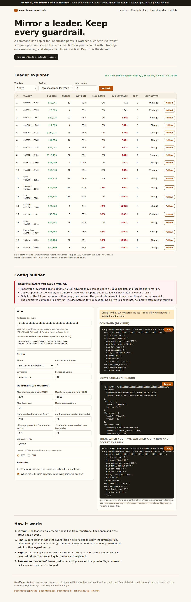

# papertrade-copytrade

[](LICENSE)
[](https://github.com/nirholas/papertrade-copytrade)
[](https://papertrade.xyz)
[](https://github.com/nirholas/papertrade-copytrade/stargazers)
[](https://github.com/nirholas/papertrade-copytrade/commits/main)
[](#the-papertrade-toolkit)

[Live site](https://papertrade-copytrade.pages.dev) · [Issues](https://github.com/nirholas/papertrade-copytrade/issues) · [Discussions](https://github.com/nirholas/papertrade-copytrade/discussions) · [Papertrade](https://papertrade.xyz) · [Toolkit](#the-papertrade-toolkit)

Unofficial copy-trading CLI and library for [Papertrade](https://papertrade.xyz), the fully on-chain 1000x synthetic perps exchange on HyperEVM (chain 999). Not affiliated with Papertrade. **1000x leverage can lose your whole margin in seconds, and a leader's past results predict nothing.**

It ranks live leaders, streams a leader's wallet, and mirrors their opens and closes into your account with a trading-only session key, stopping at limits you set first. Dry run is the default.

Site and config builder: https://papertrade-copytrade.pages.dev



## Quick start

```sh
npx papertrade-copytrade leaders --window 7d --sort low-leverage
npx papertrade-copytrade inspect 0x...leader
npx papertrade-copytrade follow 0x...leader \
  --account 0x...you --sizing fixed:250 --leverage cap:50 \
  --max-margin-per-trade 300 --max-total-margin 1000 --max-leverage 50 \
  --max-positions 3 --daily-loss-limit 200 --markets BTC,ETH \
  --cooldown 30 --kill-switch ./STOP --max-slippage 0.5
```

That last command is a dry run: it logs `would_sign` (the full signed intent) and `simulated_open` / `simulated_close` and submits nothing. Watch it for a while first.

To go live, set the wallet key in your own terminal and add `--live`:

```sh
export PAPERTRADE_WALLET_KEY=0x...   # only registers a session key
npx papertrade-copytrade follow ... --live
```

You must type `start live copying` in an interactive terminal. Pipes, cron and CI are refused.

## Commands

| Command | What it does |
| --- | --- |
| `leaders [--window 24h\|7d\|30d\|all] [--sort ...] [--limit 25] [--min-trades 3] [--json]` | Leaderboard joined with stats from each wallet's recent closed trades. |
| `inspect <address> [--window 7d] [--json]` | One wallet's stats and open positions. |
| `follow <address...> [options]` | Mirror one or more leaders (up to 10). |
| `check --config <file>` | Validate a config and print the resolved guardrails. |

## Sizing and leverage

- `--sizing fixed:<usd>`: the same margin every trade.
- `--sizing proportional:<x>`: x times the leader's margin.
- `--sizing percent:<pct>`: a percent of your available balance.
- `--leverage copy`: the leader's leverage. `cap:<n>`: the leader's, capped at n. `fixed:<n>`: always n.

Protocol minimums are enforced: $10 margin and $10,000 notional. When your sizing and leverage cannot reach $10,000 notional inside your guardrails, the copy is skipped and the reason is logged (for example `notional_below_minimum`). Nothing is silently rounded up past a guardrail.

## Guardrails (all required)

There is no default that allows unlimited risk. `follow` refuses to start with any of these missing.

| Flag | Meaning |
| --- | --- |
| `--max-margin-per-trade` | Largest margin for one copied position. |
| `--max-total-margin` | Largest total margin across all mirrored positions. |
| `--max-leverage` | Hard leverage ceiling, applied after the leverage rule. |
| `--max-positions` | Most mirrored positions open at once. |
| `--daily-loss-limit` | Stop opening new copies once realized loss in the UTC day reaches this. |
| `--markets` | Allowlist, for example `BTC,ETH`. |
| `--cooldown` | Seconds between opens on the same market. |
| `--kill-switch` | Create this file to stop new copies. Add `--flatten-on-kill` to also close mirrored positions. |
| `--max-slippage` | Skip when the mark has moved more than this percent from the leader's entry. |

Also: `--max-leader-age` (skip stale leader opens, default 60 seconds), `--copy-existing` (also copy positions the leader held at start, off by default), `--state <file>` (default `./copytrade-state.json`), `--assume-balance <usd>` (dry run only), `--json` (structured log lines), `--level`, `--duration <seconds>`.

A config file can hold everything (flags override it):

```json
{
  "account": "0x...",
  "leaders": ["0x..."],
  "sizing": { "mode": "fixed", "marginUsd": 250 },
  "leverage": { "mode": "cap", "max": 50 },
  "guardrails": {
    "maxMarginPerTradeUsd": 300, "maxTotalOpenMarginUsd": 1000, "maxLeverage": 50,
    "maxOpenPositions": 3, "dailyLossLimitUsd": 200, "markets": ["BTC", "ETH"],
    "cooldownSeconds": 30, "killSwitchFile": "./STOP", "maxSlippagePct": 0.5
  }
}
```

## How it works

1. `streamWallet` (from [papertrade-sdk](https://github.com/nirholas/papertrade-sdk)) reads each leader's live wallet feed. The first event is a snapshot (the baseline, never copied unless `--copy-existing`), later events are patches.
2. A pure planner (`planEvent`, `planDue`) turns each leader event plus your state into actions: open, close or skip with a reason.
3. A session key signs the EIP-712 intent. The wallet key signs only the one-time session-key registration.
4. Mapping of leader position to your position is saved to the state file before each submit and reconciled against your own wallet stream, so a restart recovers cleanly and a crash mid-submit never double-opens.
5. SIGINT or SIGTERM stops the streams, saves state and tells you which mirrored positions stay open.

## Library

```ts
import { resolveConfig, planEvent, rankLeaders, computeTradeStats } from 'papertrade-copytrade';
```

`planEvent(event, followerState, config, market)` is pure and deterministic. See `src/index.ts` for every export.

## Environment

| Variable | Needed for |
| --- | --- |
| `PAPERTRADE_WALLET_KEY` | `--live` only. Registers a trading-only session key. Never logged. |
| `PAPERTRADE_API_URL` | Site proxy upstream (`site/wrangler.toml`, default `https://exchange.papertrade.xyz`). |

## Known limits

- Cloudflare rate-limits the live stream per IP. Following many leaders from one address can hit HTTP 429; the stream recovers on its own when the window clears. Prefer few leaders.
- Copies open after the leader at a different price, with fees and slippage. Results will differ from the leader's.
- Mirrored positions stay open when you stop the process. Use the kill switch with `--flatten-on-kill` if you want them closed.

## Development

```sh
npm install
npm run typecheck && npm test && npm run build
npm run dev:site          # http://localhost:8797
node scripts/verify-wire.mjs   # throwaway key must get 403 unauthorized_intent
node scripts/record-stream.mjs # re-record test fixtures from the live API
```

Tests replay recorded real wallet streams through the engine (`test/fixtures/`).

## Deploy

```sh
gh repo create nirholas/papertrade-copytrade --public --source . --push
npm run build:site && cd site && npx wrangler pages deploy
npm publish
```

## The Papertrade toolkit

Nine open-source building blocks for [Papertrade](https://papertrade.xyz), the fully on-chain 1000x perps exchange on Hyperliquid HyperEVM. Use them together or on their own.

| Project | What it does |
|---|---|
| [papertrade-ai](https://github.com/nirholas/papertrade-ai) | MCP server and CLI: trade Papertrade from Claude, ChatGPT, Cursor and any MCP client |
| [papertrade-sdk](https://github.com/nirholas/papertrade-sdk) | Typed API client, live account stream, EIP-712 signing and verified settlement math. |
| [papertrade-terminal](https://github.com/nirholas/papertrade-terminal) | Non-custodial web trading terminal with charts, order ticket, funding and swaps. |
| [papertrade-analytics](https://github.com/nirholas/papertrade-analytics) | DefiLlama-style dashboard and JSON API: TVL, volume, OI, PAPER economics. |
| [papertrade-explorer](https://github.com/nirholas/papertrade-explorer) | Linkable wallet pages, decoded transactions and a live leaderboard. |
| [papertrade-liquidations](https://github.com/nirholas/papertrade-liquidations) | Liquidation map and closest-to-bust feed, recomputed with the verified formula. |
| [papertrade-yield](https://github.com/nirholas/papertrade-yield) | PAPER staking dashboard with realized USDC yield and wallet-signed actions. |
| [papertrade-alerts](https://github.com/nirholas/papertrade-alerts) | Know before the liquidation: Telegram, Discord and webhook alerts. |
| **papertrade-copytrade** (this repo) | Guard-railed copy-trading CLI. Dry run by default. |
| [papertrade-x402](https://github.com/nirholas/papertrade-x402) | Pay-per-call intelligence API for AI agents, paid in USDC on Solana or Base. |

## Contributing and support

- Found a bug or want a feature? [Open an issue](https://github.com/nirholas/papertrade-copytrade/issues/new/choose).
- Questions and show-and-tell: [Discussions](https://github.com/nirholas/papertrade-copytrade/discussions).
- Pull requests are welcome, see [CONTRIBUTING.md](CONTRIBUTING.md). Security reports go through [SECURITY.md](SECURITY.md).
- If this saved you time, a star helps other Papertrade traders and builders find it.

Built by [three.ws](https://three.ws).

## Disclaimer

Unofficial, independent, not affiliated with or endorsed by Papertrade. Not financial advice. Provided as is under the Apache-2.0 license with no warranty. Copy trading at up to 1000x leverage can lose your entire margin. Only use funds you can afford to lose.
